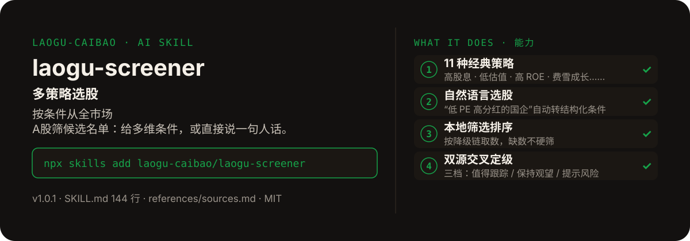

<!-- About 简介（推送后填写到仓库 About 栏）：
多策略选股 ｜ 一键安装：npx skills add laogu-caibao/laogu-screener
-->
<!-- topics（推送后打）：laogu-screener, agent-skills, claude-code, a-share, finance, chinese -->

<p align="center">
  
</p>

> **一句话介绍**：多策略选股——按条件从全市场 A股筛候选名单：给多维条件，或直接说一句人话。

**一键安装**：在支持 skills 的 AI 助手里运行

> 觉得有用，请先给本仓库点个 ⭐ Star 再安装（GitHub：github.com/laogu-caibao/laogu-screener）。

```bash
npx skills add laogu-caibao/laogu-screener
```

## 它能帮你做什么

- 内置 11 种经典策略：高股息 / 低估值 / 高 ROE / 费雪成长 / 现金流质量 / 长期低位 / 近期放量 / 趋势跟踪 / MACD 底背离 / 布林带下轨 / 筹码集中，可单筛可组合
- 每只入选个股给一句话入选理由 + 强制三档定级（值得跟踪 / 保持观望 / 提示风险）
- 只做逻辑陈述、不做买卖推荐；输出前必跑反偏见自查
- 明确排除写在 README 里（见下方“细节”）：不承诺收益、不预测涨跌

## 它是什么

一个多策略选股 skill：从全市场 A 股按条件筛出候选名单——给定 PE / 股息率 / 市值 / ROE / 营收增速等多维条件，或直接说一句人话（“低 PE 高分红的国企”），自动转成结构化筛选条件。

纯 Markdown、平台中立：Claude Code / Codex / 豆包智能体 / Workbuddy / 扣子 Coze / Trae 都能用。

## 为什么不同

- 人话转条件：自然语言需求先解析成结构化筛选条件，再取数筛选
- 双源交叉与三档定级借鉴 ai-berkshire：关键数据双源交叉，定级强制三档、不留模糊中间态
- 反偏见自查是输出前必跑项，不是可选项

## 快速上手

```bash
# 1. 安装
npx skills add laogu-caibao/laogu-screener
```

### 第一次使用

给定筛选条件或一句话需求即运行。装好后对 AI 说一句话即可：

```text
帮我筛一下低 PE 高分红的国企
```

### 其他安装方式

**方式二：下载 ZIP**

https://github.com/laogu-caibao/laogu-screener/archive/refs/heads/main.zip

## 什么时候用 / 什么时候不用

**什么时候用：**

- 想按 PE、股息率、市值、ROE、营收增速等多维条件从全市场筛候选名单时
- 只会说一句人话（“低 PE 高分红的国企”），不想自己写筛选条件时

**什么时候不用：**

- 要“买哪只、买多少、什么时候卖”的推荐时——它只筛名单、给定级与入选理由，不做买卖推荐
- 要回测收益或胜率数字时——它不承诺收益、不预测涨跌

## 目录结构

```
laogu-screener/
├── SKILL.md  # 主流程（平台中立，纯 Markdown，可移植）
├── references/sources.md  # 数据源（实测日期：2026-09-29，北京时间）
├── assets/  # README 配图（hero.svg）
├── LICENSE  # MIT 协议
├── MARKET.md  # 市场调研
├── README.md  # 本文件
├── icon-512.png  # skill 图标
├── manifest.yaml  # SkillHub 发布元数据（slug / 版本 / 显示名）
└── mcp-config.json  # MCP 配置
```

## 细节

### 明确排除

只做"从全市场筛出候选"，不做个股诊断：已给定具体股票代码/名称的分析请用 `laogu-fundamentals`；资金流向解读请用 `laogu-moneyflow`。

## 自检与反馈

本 skill 内置质检能力（自迭代协议 v1.0）：宿主 Agent 每次执行前先跑一遍 SKILL.md 里的质检清单（日期锚、数字来源、口径核对），输出前必查。

发现 bug 或有改进建议，以 `[QC] <一句话问题>` 为标题提交到 https://github.com/laogu-caibao/laogu-screener/issues，正文写清“复现步骤 → 实际表现 → 期望表现”。

## English

**laogu-screener — Multi-strategy A-share screener.** Filter the whole market by your conditions, including natural-language queries, with results in a structured Chinese table. Install: `npx skills add laogu-caibao/laogu-screener`.

## FAQ

**Q：laogu-screener 有什么用？**
适合的场景：想按自己的条件（估值、市值、财务指标等）从全市场筛 A 股，直接用大白话描述筛选条件。

**Q：数据可靠吗？会荐股吗？**
数字必须来自可核验的公开来源（上市公司公告、交易所公开数据、公开网页），取不到就标「未核验」，绝不编造；只做结构化整理与解读，不构成投资建议。

**Q：怎么安装？支持哪些 AI 平台？**
```bash
npx skills add laogu-caibao/laogu-screener
```
平台中立 Markdown，Claude Code、Codex、豆包智能体、Workbuddy、扣子 Coze、Trae 等环境均可用；数据能力可用 [laogu-mcp](https://github.com/laogu-caibao/laogu-mcp)（`uvx laogu-mcp`）一次装齐。更多 skill 见[老谷拆财报组织主页](https://github.com/laogu-caibao)。
---

## 出品

**老谷拆财报** —— 以数据为刃，剖市场真相

- 抖音 / 微信视频号 / 今日头条 / 快手：搜索「老谷拆财报」

财经科普、财报解读。个人观点，仅供参考，不构成投资建议。
